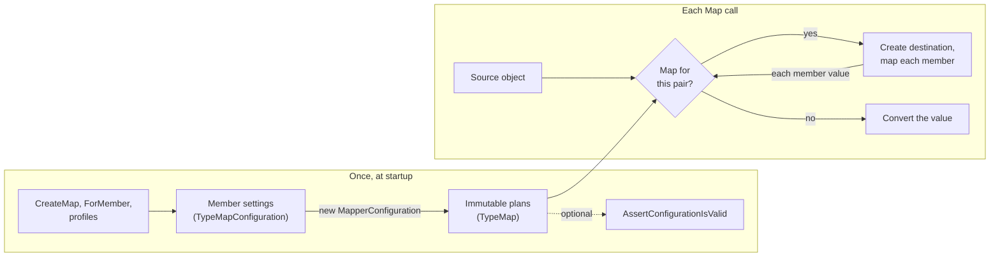

# How mapping works

PureMapper does its work in two phases. Creating the configuration turns your maps into plans, once, and a `Map` call then follows a plan, as often as you like. Most of its behavior follows from this split.

## Configuration: from settings to plans

While your configuration lambda runs, `CreateMap` and `ForMember` only collect settings. The only check at this point is that a `ForMember` refers to an existing destination property. This is why it does not matter in which order you define maps, even when one depends on another.

When the `MapperConfiguration` constructor continues, each map becomes a plan, called a `TypeMap`. For each one, PureMapper:

1. decides how the destination gets created: your factory, a parameterless constructor, or the largest constructor;
2. goes through the destination's writable properties and constructor parameters, and finds a source for each by [the matching rules](../reference/mapping-rules.md#finding-the-source-of-a-member); and
3. compiles delegates to read and write the properties, so reflection is not needed for this later on.

Members without a source are noted in the plan as unmapped, and otherwise left out of it. This has a consequence that can be surprising: the plan is complete and works even with unmapped members. They are not an error until you [ask for validation](design-decisions.md#validation-is-a-separate-step).

The plans do not refer to each other. A plan records that member `Lines` comes from a `List<OrderLine>` and goes to an `OrderLineDto[]`, not which other plan to use for its elements.

## Mapping: one recursive step

At runtime, all the work is done by a single small recursive step, applied first to the object you pass in and then to the value of each member:

1. A `null` becomes the default of the destination type.
2. If there is a plan for the source's runtime type and the destination type, follow it. Each member's value goes back to step 1.
3. Otherwise, convert the value: copy a collection (element by element, each back to step 1), pass on an assignable object, or convert a string, enum or other simple value.

Three things that may look like separate features are all just this step:

- **Nested objects** work because the member value is treated the same as the object you passed to `Map`.
- **Collections** work because each element is too. That is why you create maps for elements and not for collections.
- **Inheritance** works because plans are looked up with the type the object really has at that moment, not the declared type of the property.

The lookup happens at runtime for the same reason. It is also why a map you define for a collection type or a pair like `string` to `Guid` applies everywhere: plans are checked before conversions, so a plan can replace any built-in conversion.

Results of the lookup are cached per pair of types, so the walk through base classes and interfaces only happens once.

This step also explains the two main limits. It has no memory of objects it already visited, so a [circular reference](../how-to/handle-circular-references.md) recurses until the stack is exhausted. And when mapping onto an existing object, only the top-level call gets a destination: member values are always mapped to new objects, which is why [nested objects are replaced](../how-to/update-an-existing-object.md#nested-objects-and-collections-are-replaced).

## Flattening

Flattening is resolved in the configuration phase, by name alone. For the member `CustomerAddressCity`, PureMapper looks for a source property whose name starts that string, and then repeats that on the property's type with the rest of the name, until it arrives at `Customer` → `Address` → `City`. Longer prefixes are tried first, and if a path turns out to be a dead end, the next shorter prefix is tried.

The plan stores the resulting chain of getters. If a link in it gives `null`, the chain stops and gives `null`. That makes the null safety a feature of the path rather than something you have to request, and it is also why `MapFrom`, being your own code, does not have it.

## Related

- [Mapping rules](../reference/mapping-rules.md)
- [Performance and thread safety](performance-and-thread-safety.md)
- [Design decisions](design-decisions.md)
